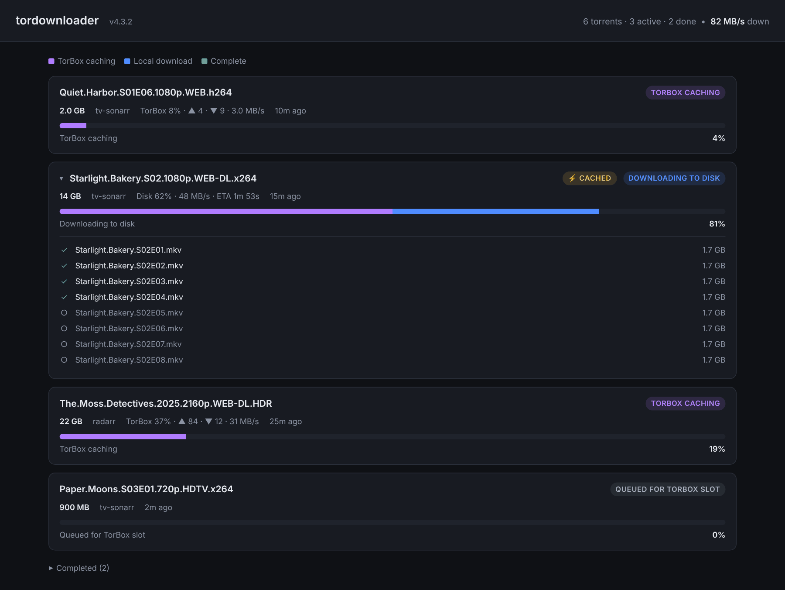

<p align="center">
  
</p>

<h1 align="center">tordownloader</h1>

<p align="center">TorBox as a download client for Sonarr and Radarr.</p>

<p align="center">
  <a href="https://github.com/Guibibi/tordownloader/tags"></a>
  <a href="https://github.com/Guibibi/tordownloader/actions/workflows/docker-publish.yml"></a>
  <a href="go.mod"></a>
  <a href="https://github.com/Guibibi/tordownloader/pkgs/container/tordownloader"></a>
  <a href="LICENSE"></a>
</p>

tordownloader implements the qBittorrent WebUI API, so Sonarr and Radarr can use it as a regular
qBittorrent download client. Torrents it receives are sent to [TorBox](https://torbox.app), and
once TorBox has them, the files are downloaded to a local folder for Sonarr/Radarr to import. There
is no mount involved; the files end up on your disk like with any other download client.

It's similar to [rdt-client](https://github.com/rogerfar/rdt-client) and
[decypharr](https://github.com/sirrobot01/decypharr), but only supports TorBox, has no settings UI,
and always downloads to disk.


<sub>The status page at `http://<host>:6500/` (demo data).</sub>

## Features

- Works with Sonarr, Radarr and other qBittorrent clients such as nzb360, without plugins.
- Keeps the torrent's folder structure. Files are written to a staging folder and moved into place
  when complete, so partial files are never imported.
- Fails torrents that stall or download too slowly to finish, and (if configured) tells
  Sonarr/Radarr to blocklist the release and search for another one.
- Respects the TorBox plan's concurrent download limit and API rate limits, queuing the rest.
- Removing a download in Sonarr/Radarr also removes it from TorBox and from disk.
- Checks free disk space before starting a download.
- Retries interrupted transfers, resuming from the data already on disk.
- Read-only status page, `/healthz` endpoint, and Prometheus metrics at `/metrics`.
- Single Go binary, SQLite for state, configured through environment variables or YAML.

## How it works

```
Prowlarr ──> Sonarr/Radarr ──(qBittorrent API)──> tordownloader ──(TorBox API)──> TorBox
                  ^                                      │
                  └────────── imports from ──────────────┘
                          shared /downloads folder
```

1. Sonarr/Radarr send a torrent to tordownloader.
2. tordownloader adds it to TorBox and tracks its progress.
3. When TorBox is done, the files are downloaded to `/downloads/<category>/<name>/`.
4. Sonarr/Radarr see the download as complete and import it.
5. When Sonarr/Radarr remove the download, it is deleted from TorBox and from disk.

## Requirements

- A TorBox account and API key. Tested on the Essential plan.
- Sonarr and/or Radarr.
- A downloads folder mounted at the same path in tordownloader and in Sonarr/Radarr (see below).
- Docker.

## Installation

### Docker Compose

Download [`docker-compose.yml`](docker-compose.yml), set the `/downloads` volume to the folder
Sonarr/Radarr use, and run:

```bash
TORBOX_API_KEY=your-key docker compose up -d
```

### Unraid

A template is included at [`unraid/tordownloader.xml`](unraid/tordownloader.xml). On the Unraid
server, download it into the user templates folder:

```bash
wget -O /boot/config/plugins/dockerMan/templates-user/my-tordownloader.xml \
  https://raw.githubusercontent.com/Guibibi/tordownloader/main/unraid/tordownloader.xml
```

Then go to Docker → Add Container, pick **tordownloader** from the Template list, and fill in the
TorBox API key and (recommended) the Sonarr/Radarr URL and API key. A `config.yaml` placed in
`/mnt/user/appdata/tordownloader/` is picked up on restart.

To set it up by hand instead, use Docker → Add Container with:

| Field | Value |
|---|---|
| Repository | `ghcr.io/guibibi/tordownloader:latest` |
| Port | `6500` → `6500` |
| Path `/data` | `/mnt/user/appdata/tordownloader/` |
| Path `/downloads` | `/mnt/user/downloads/` |
| Variable `TORBOX_API_KEY` | your TorBox API key |
| Variable `PUID` / `PGID` | `99` / `100` |

### docker run

```bash
docker run -d \
  --name tordownloader \
  -e TORBOX_API_KEY=your-api-key \
  -e PUID=99 -e PGID=100 \
  -v /path/to/data:/data \
  -v /mnt/user/downloads:/downloads \
  -p 6500:6500 \
  --restart unless-stopped \
  ghcr.io/guibibi/tordownloader:latest
```

Images are published for amd64 and arm64. Use `:latest` or a version tag such as `:v0.14.0`.

### From source

Requires Go 1.26+.

```bash
go build ./cmd/tordownloader
docker build --build-arg VERSION=v0.14.0 -t tordownloader:v0.14.0 .
```

## Connecting Sonarr and Radarr

Settings → Download Clients → + → qBittorrent:

| Field | Value |
|---|---|
| Host | IP of the host running tordownloader |
| Port | `6500` |
| Username / Password | any value (authentication is not checked) |
| Category | `tv-sonarr` (Sonarr) or `radarr` (Radarr) |

The same host and port work for other qBittorrent clients, such as nzb360.

> [!IMPORTANT]
> The downloads folder must be mounted at the same path in tordownloader, Sonarr and Radarr.
> Otherwise imports fail, or fall back to copying instead of hardlinking. LinuxServer images use
> `/downloads`, which is the default here. For other images, set `TD_DOWNLOAD_ROOT` to their path.

### Failed downloads

Sonarr and Radarr don't act on qBittorrent's error state, so a failed torrent would otherwise stay
in their queue until removed by hand. If you provide their URLs and API keys, tordownloader removes
failed items through their API with blocklisting enabled, which triggers a search for another
release:

```bash
TD_SONARR_URL=http://192.168.1.50:8989
TD_SONARR_API_KEY=your-sonarr-api-key
TD_RADARR_URL=http://192.168.1.50:7878
TD_RADARR_API_KEY=your-radarr-api-key
```

Each URL needs its matching key. If only one of the pair is set, it is ignored and a warning is
logged.

## Configuration

| Variable | Default | Description |
|---|---|---|
| `TORBOX_API_KEY` | required | TorBox API key |
| `PUID` / `PGID` | `99` / `100` | Owner of downloaded files |
| `TD_LISTEN_ADDR` | `0.0.0.0:6500` | Listen address for the API and status page |
| `TD_DOWNLOAD_ROOT` | `/downloads` | Download folder |
| `TD_DB_PATH` | `/data/tordownloader.db` | SQLite database |
| `TD_LOG_LEVEL` | `info` | `debug`, `info`, `warn`, `error` |
| `TD_LOG_FORMAT` | `text` | `text` or `json` |
| `TD_SONARR_URL` / `TD_SONARR_API_KEY` | unset | Sonarr, for failed-download handling |
| `TD_RADARR_URL` / `TD_RADARR_API_KEY` | unset | Radarr, for failed-download handling |

Other settings (slot count, stall and slow-download timeouts, minimum speed, free-space reserve,
poll interval) are only available in the config file. See
[`config.example.yaml`](config.example.yaml) for all options, then mount your copy and pass
`--config /config.yaml`.

## Notes

- TorBox's Essential plan limits a single download to 200 GB. Larger packs are rejected and
  reported as failed, and Sonarr will try a smaller release.
- At startup the TorBox account is checked, and problems (invalid key, expiring subscription, slot
  count above the plan's) are logged.
- Failed torrents are removed after 7 days once they've been handled (`failure.error_retention`).
- There is no authentication. Run it on a trusted network only.

## Documentation

- [Architecture](docs/ARCHITECTURE.md): components, state machine, data model
- [API reference](docs/API_REFERENCE.md): emulated qBittorrent endpoints, TorBox endpoints used,
  state mapping

## License

[MIT](LICENSE)
